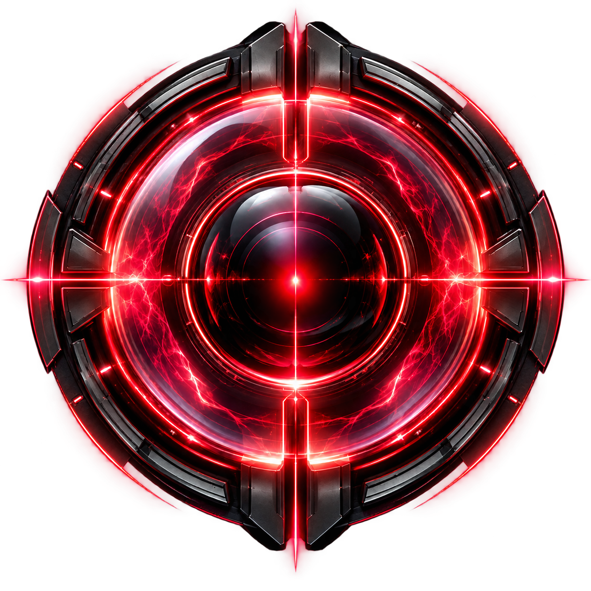
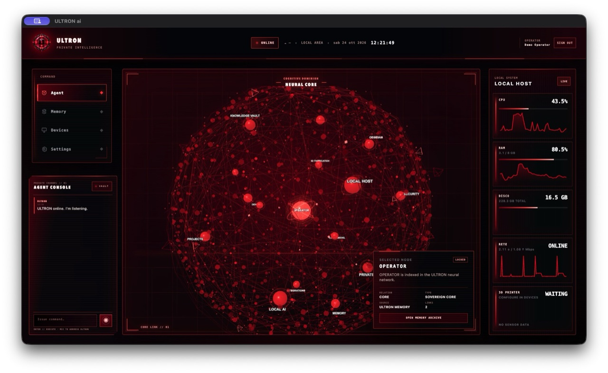
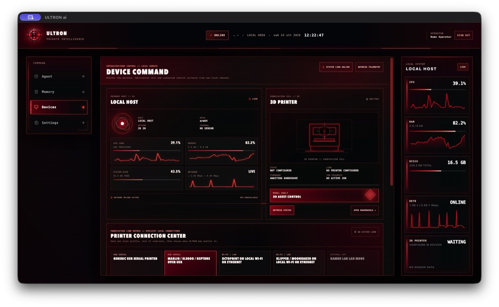
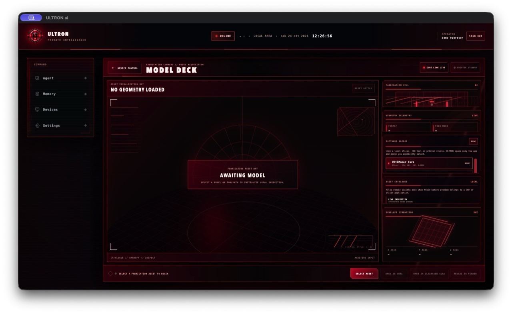
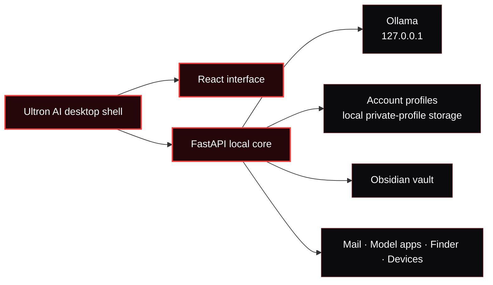

<p align="center">
  
</p>

<h1 align="center">Ultron AI</h1>

<p align="center">
  <strong>A private, local-first AI command center for macOS and Windows.</strong><br />
  Run your assistant, memory, devices, Obsidian vault and 3D workflow from one desktop interface.
</p>

<p align="center">
  
  
  
  
  
</p>

<p align="center">
  <a href="#download-and-first-launch">Download</a> ·
  <a href="#build-and-run-from-source-developers">Build from source</a> ·
  <a href="#what-is-inside">Features</a> ·
  <a href="#privacy-and-security">Privacy</a> ·
  <a href="#build-desktop-packages">Build</a> ·
  <a href="docs/RELEASE.md">Release guide</a>
</p>

## See Ultron AI in action

<p align="center">
  
</p>

<p align="center"><em>The Neural Core: a local command center for the agent, memory, devices and system telemetry.</em></p>

<table>
  <tr>
    <td width="50%" valign="top">
      
      <strong>Device Command</strong><br />
      Monitor the Mac, choose an explicit printer connection and open the 3D workflow from one local panel.
    </td>
    <td width="50%" valign="top">
      
      <strong>Model Deck</strong><br />
      Inspect local fabrication assets and hand the selected file to a local slicer, CAD tool or printer studio.
    </td>
  </tr>
</table>

_All screenshots use an isolated demo operator. They contain no vault, email, selected model or personal account data._

---

> [!IMPORTANT]
> Ultron AI keeps accounts, memory and its core on the local computer. Each
> platform package is built natively and only appears on GitHub Releases after
> its own verification workflow succeeds.

---

## Download and first launch

[**Open Ultron AI downloads →**](https://github.com/Lumacaonta/Ultron-AI/releases)

Choose an asset that exactly matches the computer. The release page shows only
the platforms that completed a native release workflow:

| Computer | Download name | Install |
| --- | --- | --- |
| Mac with M1, M2, M3, M4 or later | **-macos-arm64.dmg** | Open the DMG and drag **Ultron AI.app** to **Applications**. |
| Mac with an Intel processor | **-macos-x64.dmg** | Open the DMG and drag **Ultron AI.app** to **Applications**. |
| 64-bit Windows 10 or Windows 11 | **-windows-x64-Setup.exe** | Run Setup, then start **Ultron AI** from the Start menu. |

Each platform also has a portable ZIP and SHA-256 checksums. Use the ZIP only
when you specifically want a portable copy; the DMG and Setup installer are
the normal choices.

The downloaded app already includes its interface and local core. **You do not
need Node.js, Python, Git or a developer .env file to use it.** Create a local
account when it starts, then follow the short Quick Tour to connect only the
features you want.

A candidate release can be unsigned or ad-hoc signed. macOS may show a
Gatekeeper warning until Apple notarization is complete; Windows may show a
SmartScreen warning until Authenticode signing is complete. The GitHub release
notes state the signing status. Read [platform support](docs/PLATFORM_SUPPORT.md)
before downloading a candidate.


---

## What is inside

| Surface | What it does |
| --- | --- |
| **Agent Console** | Talk to a local Ollama model, keep the recent conversation context, use voice input, prepare memory entries and send reviewed actions. |
| **Neural Core** | Explore a live 3D relationship graph for local knowledge, devices, vault content and saved memory. |
| **Memory Vault** | Store only confirmed memories; browse an Obsidian vault without importing it automatically. |
| **Model Deck** | Catalog any selected local fabrication file. Inspect supported meshes and toolpaths in-app; hand CAD, slicer and other native formats to Cura, Bambu Studio, OrcaSlicer, PrusaSlicer or a linked local app after an explicit action. |
| **Device Control** | See local system activity and configure one explicit printer profile: Marlin-compatible USB, OctoPrint on local Wi-Fi/Ethernet, or Klipper/Moonraker on local Wi-Fi/Ethernet. |
| **Accounts and Mail** | Create local email/password accounts with isolated Ultron AI profiles; optionally configure SMTP verification and recovery codes. macOS Mail actions are available only on macOS. |

### Local by default

- **Ollama** powers chat and memory extraction on your machine.
- **Obsidian** remains your vault. Ultron AI reads it on demand and writes only after an explicit action.
- **Cura, Bambu Studio, OrcaSlicer, PrusaSlicer, the local file manager, Mail on macOS and serial devices** are called only after an explicit action.
- **Printer telemetry** is read-only. Ultron AI does not upload jobs, move axes, set temperatures or discover devices across your network.
- **No Ultron AI cloud account, cloud sync or telemetry pipeline** is included.

---

## Architecture



The packaged application serves its interface from `ultron://app`, starts the local API on a **new loopback port for every launch**, and requires a per-launch desktop capability. It does not expose the core to the LAN by default.

---

## Build and run from source (developers)

This section is for people who want to modify Ultron AI or run it from a cloned
repository. It is separate from installing the downloadable app above.

### 1. Install the prerequisites

| Required | Optional integrations |
| --- | --- |
| macOS Apple Silicon/Intel or Windows x64 · Node.js 22.13+ · Python 3.11+ · Git | [Obsidian](https://obsidian.md/download), [UltiMaker Cura](https://ultimaker.com/software/ultimaker-cura/), Bambu Studio, OrcaSlicer, PrusaSlicer, SMTP, [Fish Audio](https://fish.audio/) |
| [Ollama](https://ollama.com/download) | A local Obsidian vault and a supported 3D printer |

### 2. Clone and bootstrap

On macOS:

```bash
git clone https://github.com/Lumacaonta/Ultron-AI.git
cd Ultron-AI
./scripts/bootstrap.sh
```

The macOS bootstrap script creates a safe local `backend/.env`, a Python
environment and reproducible Node dependency installs from the lockfiles.

On Windows, use native 64-bit PowerShell and run the matching bootstrap script:

```powershell
git clone https://github.com/Lumacaonta/Ultron-AI.git
cd Ultron-AI
pwsh -NoProfile -ExecutionPolicy Bypass -File ./scripts/bootstrap-windows.ps1
```

It creates the local Python environment, copies the safe `.env` example only
when one does not already exist, and installs the locked frontend and desktop
dependencies. It never copies a vault, account or selected model into source.

The downloaded installer does not use either of these developer setup paths.

### 3. Install a local model

Ultron AI uses `llama3.2` by default. Browse available sizes on the [official Ollama Llama 3.2 page](https://ollama.com/library/llama3.2).

```bash
ollama pull llama3.2
```

### 4. Start Ultron AI for development

On macOS:

```bash
# Terminal 1 — local core
backend/.venv/bin/python backend/launcher.py

# Terminal 2 — interface
npm --prefix frontend run dev
```

On Windows:

```powershell
# PowerShell window 1 — local core
backend/.venv/Scripts/python.exe backend/launcher.py

# PowerShell window 2 — interface
npm --prefix frontend run dev
```

Open the local Vite address printed in the second terminal or PowerShell
window.

---

## Set up an installed copy

After you create a local account, Ultron AI shows a six-step Quick Tour. It is
designed to get a new installation running without a technical setup screen:

1. Connect Ollama only if you want local AI replies.
2. Choose an Obsidian vault only if you want Ultron AI to browse local notes.
3. On macOS, add Gmail through macOS Internet Accounts only if you want the Mail tools. Windows leaves Mail disabled until a dedicated provider integration is available.
4. Open Devices and choose a printer profile when you want read-only status through USB, OctoPrint or Moonraker. Use Model Deck to choose a file, open a linked local app for its own printer setup, or pass the file to Cura, Bambu Studio, OrcaSlicer, PrusaSlicer or another local app.
5. Press **VAULT** in chat only when you want that command written to the
   Ultron AI note; ordinary chat is not silently archived.
6. Set a Global Position only when you choose to search for a place or use the
   device-location control.

You can skip any step and finish it later in Settings. The guide is available
again from **Settings → Advanced → Open Quick Tour**.

<details>
<summary><strong>Account email and password recovery</strong></summary>

Ultron AI accounts live on the local installation. SMTP is optional: leave its fields empty for an offline local account.

If you configure SMTP, Ultron AI delivers a short, one-time verification or recovery code. Email credentials require SSL or STARTTLS by default. The code expires and can be used once.

The assistant's Mail integration is separate: on macOS it operates through the account already configured in Mail and sends a message only from an explicit reviewed action. It is not included in the Windows package.

</details>

<details>
<summary><strong>Advanced configuration for source builds</strong></summary>

This section applies only when you cloned the repository and run Ultron AI from
source. It does **not** apply to a downloaded installer: configure supported
integrations there through the app's Settings screens instead.

For a source build, copy [`backend/.env.example`](backend/.env.example) to
`backend/.env` and change only what you need.

| Setting | Use |
| --- | --- |
| `ULTRON_OLLAMA_URL`, `ULTRON_OLLAMA_MODEL` | Select the local Ollama endpoint and model. |
| `ULTRON_MEMORY_MODEL` | Select the model used for memory extraction. |
| `ULTRON_AUTH_REQUIRE_EMAIL_VERIFICATION` | Require email confirmation when SMTP is configured. |
| `ULTRON_SMTP_*` | Enable encrypted verification and recovery email. |
| `ULTRON_GEOCODER_URL` | Optional Nominatim-compatible HTTPS provider for the explicit Global Position search. |
| `FISH_API_KEY`, `FISH_VOICE_ID` | Enable optional Fish Audio text-to-speech for a source build. |

Never commit `backend/.env`, a vault, a database or an API key.

</details>

---

## Privacy and security

| Protection | Implementation |
| --- | --- |
| **Account separation** | Each Ultron AI account has its own local profile, configuration, skills and memory database. |
| **Password protection** | Passwords use scrypt hashes; session tokens are stored only as hashes in the local database. |
| **Desktop channel** | The local backend uses a random port and a per-launch capability generated by Electron. |
| **Browser isolation** | Electron uses context isolation, sandboxing, disabled Node integration, strict navigation controls and an app-owned origin. |
| **Explicit memory** | Normal chat does not silently save a memory. The person confirms a proposal before it is committed. |
| **Release hygiene** | Automated checks reject likely credentials, private paths, databases, backups and generated artifacts from tracked source. |
| **Fabrication boundary** | Printer profiles are account-scoped; saved network targets must resolve to local addresses; secrets use the platform credential store when available and otherwise remain session-only. They never appear in API responses or JSON profile files. |

> [!NOTE]
> Ultron AI profiles are separate accounts within one operating-system user account. They do not protect files from somebody who can already use that same macOS or Windows account. Use separate operating-system accounts for separate people.

### External requests

Ultron AI stays local unless you enable a feature that needs an external service:

- downloading or updating a model through Ollama;
- optional SMTP verification or recovery mail;
- voice input uses the Electron/browser SpeechRecognition service where the
  platform provides it. Its provider can be an operating-system or browser
  speech service; review the microphone and speech privacy settings before using it;
- optional Fish Audio text-to-speech, only when you configure Fish credentials.
  Fish Audio is not used for microphone input;
- web research;
- typed place search through OpenStreetMap Nominatim, only after you choose
  **Find on Globe**. The query is rate-limited and any result cache exists only
  in memory while the local core is running;
- weather refreshes through Open-Meteo.

Printer profiles are not an external cloud request: Ultron AI accepts only the
single local USB port or private LAN address you explicitly select. Bambu Lab
file handoff is available through Bambu Studio; Bambu printer pairing and
printer control remain inside Bambu Studio.

Read [SECURITY.md](SECURITY.md) for responsible disclosure guidance.

---

## Build desktop packages

Build a distributable package only on the same platform and processor that will
run it. The release scripts rebuild the interface, bundle the Python core,
check the archive and produce installer, portable archive and checksum files.

### macOS Apple Silicon

~~~bash
./scripts/bootstrap.sh
./scripts/release-macos-arm64.sh
~~~

The packaged app is created below:

~~~text
desktop/out/Ultron AI-darwin-arm64/Ultron AI.app
~~~

### macOS Intel

Use an Intel Mac or native Intel macOS runner:

~~~bash
./scripts/bootstrap.sh
./scripts/release-macos-x64.sh
~~~

The packaged app is created below:

~~~text
desktop/out/Ultron AI-darwin-x64/Ultron AI.app
~~~

### Windows x64

Use native 64-bit Windows PowerShell:

~~~powershell
pwsh -NoProfile -ExecutionPolicy Bypass -File ./scripts/release-windows-x64.ps1
~~~

The standard installer is the Setup EXE under desktop/release. It is a
candidate until an Authenticode signing workflow succeeds.

> [!CAUTION]
> A normal macOS public binary needs a **Developer ID Application** certificate
> and Apple notarization. A normal Windows public binary needs an
> **Authenticode** signature. Use the [release guide](docs/RELEASE.md) before
> publishing any installer.

## Verify a checkout

```bash
backend/.venv/bin/python scripts/security-smoke-test.py
backend/.venv/bin/python scripts/location-lookup-test.py
backend/.venv/bin/python scripts/fabrication-integration-test.py
python scripts/repository-hygiene.py
npm --prefix frontend run build
node --check desktop/main.cjs
node --check desktop/preload.cjs
node scripts/verify-windows-config.mjs
```

The checks use temporary data and no real account, model, printer, slicer or LAN target. They cover account login, logout, account isolation, memory confirmation, SMTP code delivery, API headers, CORS, the per-launch desktop channel, Global Position lookup, model selection boundaries, native-app handoff boundaries, local printer URL validation and private credential storage.

---

## Project map

```text
Ultron-AI/
├── backend/       FastAPI core, local accounts, memory and integrations
├── frontend/      React interface and the Neural Core visual system
├── desktop/       Electron shell, security boundary and native desktop packaging
├── scripts/       Bootstrap, build, release and hygiene checks
├── docs/          Public release documentation
└── .github/       Continuous verification and native release workflows
```

## Contributing

Contributions are welcome. Start with [CONTRIBUTING.md](CONTRIBUTING.md), keep personal data out of commits, and run the verification commands before opening a pull request.

## License

Released under the [MIT License](LICENSE).
