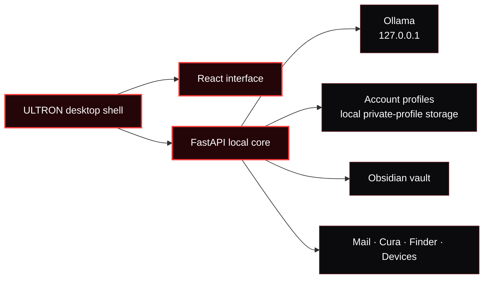

<p align="center">
  
</p>

<h1 align="center">ULTRON</h1>

<p align="center">
  <strong>A private, local-first AI command center for macOS.</strong><br />
  Run your assistant, memory, devices, Obsidian vault, email and 3D workflow from one desktop interface.
</p>

<p align="center">
  
  
  
  
</p>

<p align="center">
  <a href="#download-for-apple-silicon">Download</a> ·
  <a href="#quick-start">Quick start</a> ·
  <a href="#what-is-inside">Features</a> ·
  <a href="#privacy-and-security">Privacy</a> ·
  <a href="#build-a-macos-app">Build</a> ·
  <a href="docs/RELEASE.md">Release guide</a>
</p>

> [!IMPORTANT]
> ULTRON launches first on **macOS Apple Silicon**. It is designed for people who want a local assistant and local control surface, without an ULTRON cloud account or telemetry service.

---

## Download for Apple Silicon

The first downloadable build targets **Macs with M1, M2, M3 and later**.

[**Download the latest Apple Silicon preview →**](https://github.com/Lumacaonta/Ultron/releases)

The preview includes a ZIP and SHA-256 checksum. It has passed source, security,
archive and Apple Silicon package checks. Apple notarization requires the
maintainer's Developer ID certificate, so macOS can ask for explicit first-run
approval until the notarized release is published.

| Platform | Status |
| --- | --- |
| **macOS Apple Silicon** | Public preview now; notarized release next. |
| **macOS Intel** | Planned after Apple Silicon. |
| **Windows** | Planned after Intel Mac. |
| **Linux** | Planned after Windows. |

Read [platform support](docs/PLATFORM_SUPPORT.md) for the exact release status.

---

## What is inside

| Surface | What it does |
| --- | --- |
| **Agent Console** | Talk to a local Ollama model, keep the recent conversation context, use voice input, prepare memory entries and send reviewed actions. |
| **Neural Core** | Explore a live 3D relationship graph for local knowledge, devices, vault content and saved memory. |
| **Memory Vault** | Store only confirmed memories; browse an Obsidian vault without importing it automatically. |
| **Model Deck** | Inspect STL, OBJ, 3MF, AMF, PLY and G-code files, then reveal them in Finder or open a selected model in UltiMaker Cura. |
| **Device Control** | See local system activity, network status, serial ports and supported 3D printer information. |
| **Accounts and Mail** | Create local email/password accounts with isolated ULTRON profiles; optionally configure SMTP codes and macOS Mail actions. |

### Local by default

- **Ollama** powers chat and memory extraction on your machine.
- **Obsidian** remains your vault. ULTRON reads it on demand and writes only after an explicit action.
- **Cura, Finder, Mail and serial devices** are called through the current macOS user account.
- **No ULTRON cloud account, cloud sync or telemetry pipeline** is included.

---

## Architecture



The packaged application serves its interface from `ultron://app`, starts the local API on a **new loopback port for every launch**, and requires a per-launch desktop capability. It does not expose the core to the LAN by default.

---

## Quick start

### 1. Install the prerequisites

| Required | Optional integrations |
| --- | --- |
| macOS · Node.js 22.13+ · Python 3.11+ · Git | [Obsidian](https://obsidian.md/download), [UltiMaker Cura](https://ultimaker.com/software/ultimaker-cura/), macOS Mail, SMTP, [Fish Audio](https://fish.audio/) |
| [Ollama](https://ollama.com/download) | A local Obsidian vault and a supported 3D printer |

### 2. Clone and bootstrap

```bash
git clone https://github.com/YOUR-ACCOUNT/ultron.git
cd ultron
./scripts/bootstrap.sh
```

The bootstrap script creates a safe local `backend/.env`, a Python environment and reproducible Node dependency installs from the lockfiles.

### 3. Install a local model

ULTRON uses `llama3.2` by default. Browse available sizes on the [official Ollama Llama 3.2 page](https://ollama.com/library/llama3.2).

```bash
ollama pull llama3.2
```

### 4. Start ULTRON for development

```bash
# Terminal 1 — local core
backend/.venv/bin/python backend/launcher.py

# Terminal 2 — interface
npm --prefix frontend run dev
```

Open the local Vite address printed in the second terminal.

---

## First launch checklist

1. Create a **local ULTRON account** in the welcome screen.
2. Open **Settings → Obsidian** and select a vault if you want local note browsing.
3. Open **Devices** to select a 3D model and hand it to Cura.
4. Use the **Vault** control in chat only when you want a command archived in `ULTRON/Neural Core.md`.
5. Configure optional account-email verification or macOS Mail only when you need it.

<details>
<summary><strong>Account email and password recovery</strong></summary>

ULTRON accounts live on the local installation. SMTP is optional: leave its fields empty for an offline local account.

If you configure SMTP, ULTRON delivers a short, one-time verification or recovery code. Email credentials require SSL or STARTTLS by default. The code expires and can be used once.

The assistant's Mail integration is separate: it operates through the account already configured in macOS Mail and sends a message only from an explicit reviewed action.

</details>

<details>
<summary><strong>Advanced local configuration</strong></summary>

Copy [`backend/.env.example`](backend/.env.example) to `backend/.env` and change only what you need.

| Setting | Use |
| --- | --- |
| `ULTRON_OLLAMA_URL`, `ULTRON_OLLAMA_MODEL` | Select the local Ollama endpoint and model. |
| `ULTRON_MEMORY_MODEL` | Select the model used for memory extraction. |
| `ULTRON_AUTH_REQUIRE_EMAIL_VERIFICATION` | Require email confirmation when SMTP is configured. |
| `ULTRON_SMTP_*` | Enable encrypted verification and recovery email. |
| `FISH_API_KEY`, `FISH_VOICE_ID` | Enable optional Fish Audio text-to-speech. |

Never commit `backend/.env`, a vault, a database or an API key.

</details>

---

## Privacy and security

| Protection | Implementation |
| --- | --- |
| **Account separation** | Each ULTRON account has its own local profile, configuration, skills and memory database. |
| **Password protection** | Passwords use scrypt hashes; session tokens are stored only as hashes in the local database. |
| **Desktop channel** | The local backend uses a random port and a per-launch capability generated by Electron. |
| **Browser isolation** | Electron uses context isolation, sandboxing, disabled Node integration, strict navigation controls and an app-owned origin. |
| **Explicit memory** | Normal chat does not silently save a memory. The person confirms a proposal before it is committed. |
| **Release hygiene** | Automated checks reject likely credentials, private paths, databases, backups and generated artifacts from tracked source. |

> [!NOTE]
> ULTRON profiles are separate accounts within one macOS user account. They do not protect files from somebody who can already use that same macOS account. Use separate macOS accounts for separate people.

### External requests

ULTRON stays local unless you enable a feature that needs an external service:

- downloading or updating a model through Ollama;
- optional SMTP verification or recovery mail;
- optional Fish Audio text-to-speech;
- web research;
- typed place search through OpenStreetMap Nominatim;
- weather refreshes through Open-Meteo.

Read [SECURITY.md](SECURITY.md) for responsible disclosure guidance.

---

## Build a macOS app

Create a clean package from the repository root:

```bash
./scripts/build-macos.sh
./scripts/verify-release.sh
```

For a distributable Apple Silicon ZIP and SHA-256 checksum, run:

~~~bash
./scripts/release-macos-arm64.sh
~~~

The output app is created under:

```text
desktop/out/ULTRON ai-darwin-arm64/ULTRON ai.app
```

The release script rebuilds the interface, packages the Python core, checks the app archive and verifies its local code signature.

> [!CAUTION]
> A public macOS binary needs a **Developer ID Application** certificate and Apple notarization. The downloadable Apple Silicon build is clearly marked as a preview until that check succeeds. Build with `ULTRON_CODESIGN_IDENTITY`, then follow the [macOS release guide](docs/RELEASE.md) before publishing an official binary.

---

## Verify a checkout

```bash
backend/.venv/bin/python scripts/security-smoke-test.py
python scripts/repository-hygiene.py
npm --prefix frontend run build
node --check desktop/main.cjs
```

The security smoke test uses temporary data. It covers account login, logout, account isolation, memory confirmation, SMTP code delivery, API headers, CORS and the per-launch desktop channel.

---

## Project map

```text
ULTRON/
├── backend/       FastAPI core, local accounts, memory and integrations
├── frontend/      React interface and the Neural Core visual system
├── desktop/       Electron shell, security boundary and macOS packaging
├── scripts/       Bootstrap, build, release and hygiene checks
├── docs/          Public release documentation
└── .github/       Continuous verification workflow
```

## Contributing

Contributions are welcome. Start with [CONTRIBUTING.md](CONTRIBUTING.md), keep personal data out of commits, and run the verification commands before opening a pull request.

## License

Released under the [MIT License](LICENSE).
